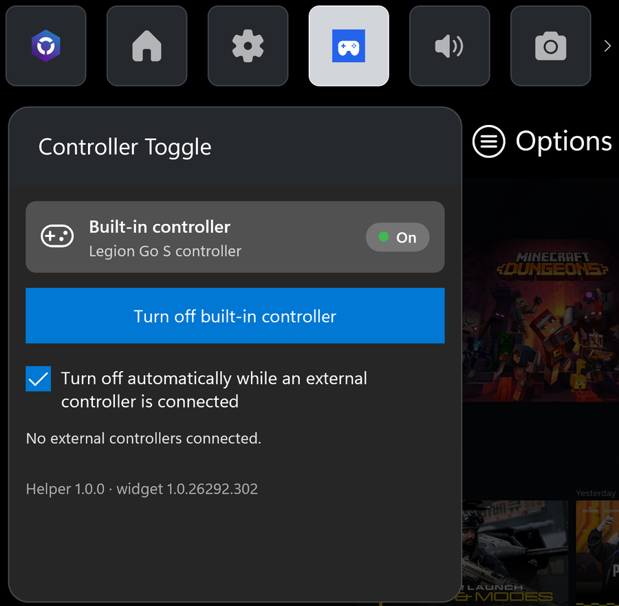
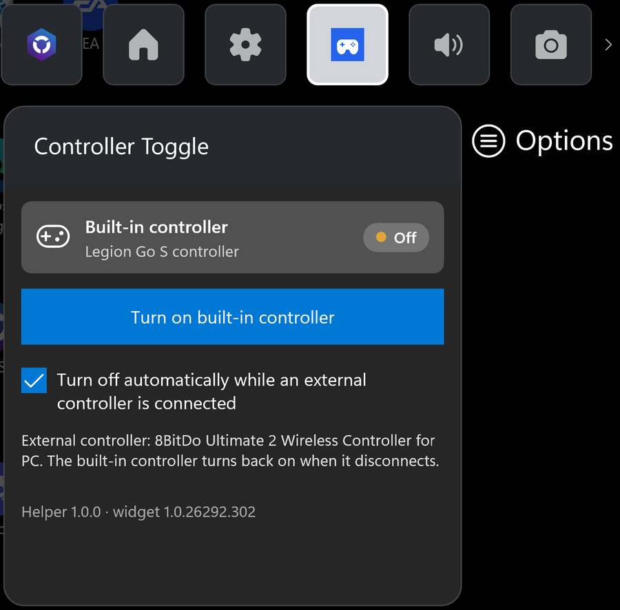

# Controller Toggle for the Legion Go S

[](https://github.com/DecentSoul-projects/GoSControllerToggle/actions/workflows/build.yml)
[](LICENSE)

**Turn your handheld's built-in controller off and on from the Xbox Game Bar.**

Dock your Legion Go S, pick up an Xbox or PlayStation controller, and games still see the
built-in gamepad as player 1, so a stray thumb on the handheld moves your character. Couch co-op
gets the player order wrong too. Controller Toggle switches the built-in controller off with one
tap, or automatically whenever another controller is connected, and turns it back on when you
undock.

<!-- SCREENSHOTS: add docs/screenshots/*.png and uncomment
<p align="center">
  
  
</p>
-->

## Features

- **One-tap toggle in Game Bar.** Press the Xbox/Game Bar button (or **Win+G**) and switch the
  built-in controller off or on. It works with touch, a mouse or an external gamepad, in the
  middle of a game.
- **Auto mode.** Connect a controller (USB, Xbox Wireless or Bluetooth) and the built-in one
  turns off. Disconnect it and the built-in one comes back by itself.
- **Really off.** The controller is disabled at the Windows level, the same as Device Manager,
  so Steam, Xbox app games and everything else stop seeing it. Nothing extra to install: no
  HidHide, no ViGEm, no drivers.
- **Shows your other controllers**, by name, so you can see at a glance what's connected.
- **Hard to get stuck.** Uninstalling always turns the controller back on, and there's an
  emergency `Restore-Controller.cmd`. The widget also warns you before you turn off your only
  controller.
- **One installer.** It sets up the widget, the background helper and the certificate the
  widget needs. After that there are no admin prompts.

## Supported devices

| Device | Status |
| --- | --- |
| **Lenovo Legion Go S** (XInput mode) | Tested |
| Legion Go, Legion Go 2, ROG Ally / Ally X, MSI Claw, Zotac Zone | Recognized, not tested yet |
| Other Windows handhelds | Detected if Windows reports their XInput controller as part of the PC |

Needs Windows 10 (2004) or Windows 11, 64-bit. Reports from other devices are welcome: open an
issue with the output of `ControllerToggleHelper.exe --list` (see
[Troubleshooting](#troubleshooting)).

## Install

1. Download **`ControllerToggle-Setup.exe`** from the
   [latest release](https://github.com/DecentSoul-projects/GoSControllerToggle/releases/latest).
2. **Turn off Smart App Control** if it's on: *Windows Security > App & browser control > Smart App
   Control settings > Off*. [Why?](#why-smart-app-control-has-to-be-off)
3. Run the installer and approve the administrator prompt. If Windows says "Windows protected
   your PC", choose **More info > Run anyway**.
4. Look for **"Found the built-in controller: Legion Go S controller"** near the end.
5. Press **Win+G** (or the Game Bar button), open **Widgets**, choose **Controller Toggle**, and
   pin it if you want it on screen.

The installer:

- trusts the widget's signing certificate in *Local Machine > Trusted People*, which Windows
  needs to install it. Nothing is added to the trusted root store;
- installs the Game Bar widget;
- installs the **Controller Toggle helper** Windows service in `C:\Program Files\ControllerToggle`.
  It starts with Windows and restarts itself if it crashes;
- adds **Controller Toggle** to *Settings > Apps*, which is where you uninstall it.

### Why Smart App Control has to be off

Smart App Control only runs apps that Microsoft already knows, or that are signed with a
certificate from a commercial certificate authority. Controller Toggle is a free project signed
with its own certificate, so Smart App Control blocks the installer and the helper. Since the
April 2026 Windows update you can turn Smart App Control back on later without reinstalling
Windows, but Controller Toggle won't run while it's on. **Turn the built-in controller back on
(or uninstall) before you re-enable it.** Microsoft Defender antivirus and SmartScreen keep
protecting you either way.

## Using it

- **Turn off built-in controller / Turn on built-in controller** switches it. The widget shows
  the state: *On*, *Off*, *Off after restart* or *Not found*.
- **Turn off automatically while an external controller is connected** is auto mode. A manual
  tap still works in auto mode and sticks until the next time a controller connects or
  disconnects.
- A manual "off" stays off after a restart, until you turn it back on.

If a game or Steam is using the controller, turning it off takes about 5 seconds: Windows tries
to stop it politely first, then the helper power-cycles its USB port to finish.

## Uninstall

*Settings > Apps > Installed apps > Controller Toggle > Uninstall*. This turns the built-in
controller back on, then removes the service, the widget and the certificate.

## Troubleshooting

- **The controller stays off.** Use touch to open the widget and turn it on, or run
  `C:\Program Files\ControllerToggle\Restore-Controller.cmd`. If the helper can't run, that
  script uses Windows' own `pnputil` instead. Device Manager can always re-enable it too: it's
  the *Xbox 360 Controller for Windows* device.
- **"Smart App Control blocked an app that may be unsafe."** See
  [above](#why-smart-app-control-has-to-be-off).
- **The widget says "Offline" or that the helper isn't reachable.** Smart App Control is on, or
  the service stopped. Check with `sc query ControllerToggle` and reinstall or restart.
- **"Not found".** Run this in a terminal and open an issue with the output:
  ```
  "C:\Program Files\ControllerToggle\ControllerToggleHelper.exe" --list
  ```
- **Logs** are in `C:\ProgramData\ControllerToggle` (`helper.log`, `install.log`).
- An Xbox 360 wireless receiver counts as an external controller while it's plugged in.

## How it works

```
 Xbox Game Bar                                     Windows
 ┌────────────────────────────┐   named pipe    ┌───────────────────────────────┐
 │ Controller Toggle widget   │  "get" "enable" │ ControllerToggle service      │
 │ (UWP, sandboxed, no admin) ├────────────────►│ (LocalSystem)                 │
 │                            │◄────────────────┤  • finds the built-in pad     │
 └────────────────────────────┘   JSON state    │  • SetupDi enable / disable   │
                                                │  • watches for external pads  │
                                                └───────────────────────────────┘
```

### Turning the controller off

It uses the same mechanism as Handheld Hardware Tools' "toggle controller", which is also
Device Manager's disable path: SetupDi `DIF_PROPERTYCHANGE` with `DICS_DISABLE` and
`DICS_FLAG_GLOBAL`, followed by a USB port power-cycle when the device can't be stopped live.
There are two differences:

- **It targets the right device.** HHT disables whichever XInput device it enumerates first,
  which can be your external pad. Controller Toggle looks for the node of a known handheld
  controller (Go S: `USB\VID_1A86&PID_E310`) that runs the Xbox 360 driver (`xusb22`). On a Go S
  that's interface `MI_01`, and `MI_00` is the built-in keyboard. Matching by driver rather than
  interface number also finds the controller while it's disabled, and never touches the
  touchpad, keyboard or vendor interfaces. On other handhelds, an XInput device counts as
  built-in if its parent chain contains a known handheld's VID/PID, or failing that if Windows
  puts it in the "part of this PC" device container.
- **It only power-cycles the port when needed** (`IOCTL_USB_HUB_CYCLE_PORT`). That's when an app
  such as Steam holds the controller open and Windows reports that a restart is required, or
  reports an error after already recording the change.

Windows stores the disabled state, so a manual "off" survives a reboot. Auto mode re-evaluates
at every start. GoTweaks and HandheldCompanion *hide* the controller with HidHide instead, which
needs a third-party driver. Disabling needs nothing extra.

### Widget ↔ helper

A Game Bar widget is a sandboxed UWP app (AppContainer, Low integrity) and can't change devices.
Like GoTweaks, the widget talks to a privileged helper over a named pipe whose ACL grants
`ALL APPLICATION PACKAGES`, and opens it with a raw `CreateFileW` because UWP's
`NamedPipeClientStream` can't. On top of that:

- the pipe has a **Low mandatory label** (`S:(ML;;NW;;;LW)`) and rejects remote clients;
- the helper is a **Windows service** installed once, rather than an elevated scheduled task
  created on first launch, so there are no UAC prompts and no setup races;
- the widget disconnects when Game Bar suspends it, and the service drops idle or stuck clients.

The protocol is one command per line (`get`, `enable`, `disable`, `auto on`, `auto off`). The
service answers with one JSON line and pushes a new one whenever something changes. It accepts
nothing else, so the most another app on the PC could do through the pipe is flip this toggle.

### Auto mode

The service listens for XInput and HID device arrivals and removals (`CM_Register_Notification`).
An **external controller** is any running XInput device or HID game controller that:

- isn't part of a known handheld,
- isn't in the PC's own device container,
- and is real hardware: it has a PCI or ACPI device above it. Virtual pads from Steam, ViGEm or
  VIIPER don't, so they're ignored.

Devices are grouped by container ID, so a pad that shows up as several nodes counts once.

## Build from source

You need Windows and **Visual Studio 2022** (Community is fine) with the C# UWP tools. In
*Visual Studio Installer > Modify*:

1. Tick the **WinUI application development** workload. It's called *Windows application
   development* in 17.10–17.12 and *Universal Windows Platform development* before that.
2. Under *Installation details*, tick **Universal Windows Platform tools**.

Then double-click **`Build.cmd`**. It finds Visual Studio and the Windows SDK, creates a
self-signed certificate in `signing\` on the first run, builds the helper and the widget, and
writes:

- `dist\ControllerToggle-Setup.exe`: the single-file installer;
- `dist\ControllerToggle-Setup.zip`: the same files (run `Install.cmd` inside).

Keep `signing\` private. Anything signed with that key is trusted on PCs where you installed
Controller Toggle, and the folder is in `.gitignore`.

No Visual Studio? Fork the repo and run the **Build** workflow in the *Actions* tab.

To publish a release: on GitHub, go to *Releases > Draft a new release* and create a new tag such
as `v1.0.1`. Publishing it starts a build that attaches `ControllerToggle-Setup.exe` and the zip
to the release (or push a `v*` tag yourself).

### Project layout

```
Build.cmd                  double-click to build
build\Build.ps1            the build (VS + SDK detection, certificate, compile, package, Setup.exe)
src\Helper\                the service (.NET Framework 4.8, x64; also a CLI: --list --status --restore ...)
  Core\                    detection (DeviceScanner), policy (ToggleCore, AutoPolicy), settings, log
  Native\                  cfgmgr32 / SetupAPI / USB hub interop, device notifications
  Ipc\PipeServer.cs        the named pipe server (+ the CLI's client)
src\Widget\                the Game Bar widget (UWP, Microsoft.Gaming.XboxGameBar 7.3)
installer\                 Install / Uninstall / Restore scripts that go into the setup
  SetupLauncher\           the single-file Setup.exe (unpacks the embedded zip, runs Install.ps1)
.github\workflows\         cloud build and releases
```

## Credits

- **[Handheld Hardware Tools](https://github.com/project-sbc/Handheld-Hardware-Tools)**
  (project-sbc): the SetupDi disable and USB port-cycle technique.
- **[GoTweaks](https://github.com/corando98/GoTweaks)** (corando98): the Game Bar widget to
  elevated helper named pipe and `CreateFileW` client technique, and the installer flow
  (`TrustedPeople` + `Add-AppxPackage`).
- **[HandheldCompanion](https://github.com/Valkirie/HandheldCompanion)** (Valkirie): handheld
  controller VID/PIDs.
- **[Xbox Game Bar samples](https://github.com/microsoft/XboxGameBarSamples)** (Microsoft, MIT):
  widget project structure, activation code and the Game Bar manifest entries.

All code here is new; only the Game Bar sample's project scaffolding was adapted.

## License

MIT, see [LICENSE](LICENSE). Fork it, change it, build on it.

Not affiliated with Lenovo or Microsoft. Legion is a trademark of Lenovo; Xbox is a trademark of
Microsoft.
